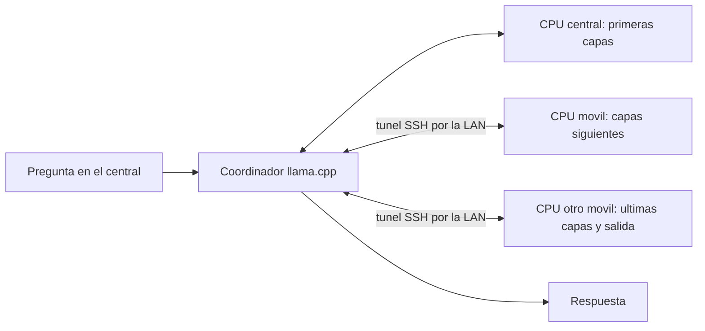

# Union LLM

Ejecuta **un mismo modelo** repartiendo sus capas entre los dispositivos que
Union LAN tiene incorporados: el central y cualquier movil que anadas con
`./union-lan invitar`. Usa la CPU de cada uno, el backend RPC de `llama.cpp`
y los alias SSH de Union LAN.

Repartir capas permite ejecutar un modelo que **no cabe en un solo telefono**:
se suma la memoria. No suma velocidad. Cada token atraviesa las capas en orden,
un dispositivo tras otro, y cada salto por la Wi-Fi anade latencia. Por eso el
programa usa, por defecto, **el menor numero de dispositivos en el que cabe el
modelo**. Los resultados medidos estan en
[`resultados/OPTIMIZACION.md`](resultados/OPTIMIZACION.md).

## Resultados

Medidos en octubre de 2026 con cuatro telefonos de gama media (2 nucleos rapidos
Cortex-A78/A75 y 6 Cortex-A55 cada uno, 5,6-7,9 GB de RAM, Android 15-16).
Datos completos y respuestas de ejemplo en
[`resultados/OPTIMIZACION.md`](resultados/OPTIMIZACION.md).

| Modelo | Dispositivos | Generacion, tokens/s |
| --- | --- | ---: |
| Qwen2.5-Coder-3B denso, solo en el central | 1 | 5,4-6,4 |
| Qwen2.5-Coder-3B denso, repartido | 3 | 0,9-1,0 |
| Qwen2.5-Coder-7B denso (4,7 GB) | 2 | 1,1-1,2 |
| Qwen2.5-Coder-7B denso (4,7 GB) | 4 | 0,49 |
| Qwen3.8-27B denso, 2 bits (7,3 GB) | 3 | 0,27 |
| **ERNIE-4.5-21B-A3B MoE, 2 bits (8,2 GB)** | **3** | **2,2** |

Lo que mas influyo, de mayor a menor:

1. **La red.** Pasar los telefonos a la Wi-Fi de 5 GHz multiplico por 10 el ancho
   de banda (de 1,6 a 15-17 MB/s) y redujo a un tercio la latencia de cada viaje.
   La primera carga de un modelo de 7 GB paso de mas de una hora, con cortes,
   a 5-7 minutos.
2. **El tipo de modelo.** Un MoE solo lee de memoria los expertos activos en cada
   token. ERNIE (21B, 3B activos) fue 8 veces mas rapido que Qwen3.8-27B denso
   con un archivo de tamano parecido, y mas rapido que el 3B denso repartido.
3. **El numero de dispositivos.** Cada telefono anade viajes por la red en cada
   token: el 7B fue 2,5 veces mas rapido en 2 dispositivos que en 4. Por eso el
   programa usa el minimo en el que cabe el modelo. Con 2 dispositivos la red
   de 5 GHz apenas cambio su velocidad (1,22 frente a 1,13 tokens/s): ahi limita
   el calculo de los telefonos, no la red.
4. **La CPU.** Compilar con `dotprod` y usar solo los 2 nucleos rapidos subio la
   generacion del 3B en el central de 3,81 a 6,37 tokens/s, y el prompt de 2,6
   a 11,8 tokens/s.

Probado y descartado en estas CPU: la decodificacion especulativa con un modelo
borrador fue mas lenta (verificar varios tokens cuesta casi lo mismo que generarlos
uno a uno), y fijar `TCP_NODELAY` en SSH no cambio la latencia.

Mas memoria por telefono deberia acelerarlo bastante, porque menos dispositivos
significan menos saltos. Con telefonos de gama alta (12 GB, memoria LPDDR5X,
mas nucleos rapidos e instrucciones `i8mm`) se espera mas velocidad por
dispositivo y modelos mayores en 2-3 telefonos; no se ha medido.

## Estructura



El coordinador lee el modelo del disco del central y envia a cada movil solo
sus capas. Las capas del central se calculan directamente en su CPU, sin pasar
por un servidor RPC propio. Cada movil guarda en `cache/rpc/` los tensores
recibidos, para no volver a transferirlos en el siguiente arranque.

## Como elige los dispositivos y reparte el modelo

Cada vez que arranca, el programa:

1. Lee los dispositivos de Union LAN (`/root/.config/union-lan/nodos.json`).
   Un movil nuevo se usa sin editar nada.
2. Consulta a la vez la memoria disponible y los nucleos de cada uno. Los que
   no responden quedan fuera con un aviso; el resto sigue funcionando.
3. Detiene trabajadores huerfanos de ejecuciones anteriores, que ocuparian
   el puerto y la memoria.
4. Copia el trabajador RPC a los moviles que no lo tienen o tienen otra version.
   Es un ejecutable estatico: funciona aunque cada movil tenga otro Debian.
5. Lee el tamano real de cada capa en la cabecera del GGUF y calcula el reparto.
   Cada dispositivo recibe capas en proporcion a su memoria util (memoria
   disponible menos una reserva para Android). El movil con mas memoria recibe
   ademas la capa de salida.
6. Si el modelo no cabe, se detiene antes de cargar nada y explica cuanta
   memoria falta. Asi evita que Android cierre Termux por falta de memoria.
7. Si el reparto anterior de ese modelo sigue cabiendo en los mismos
   dispositivos, lo reutiliza: cada movil encuentra sus capas en la cache y el
   arranque es mucho mas rapido.

Para ver el reparto de un modelo sin cargarlo:

```bash
./union-llm reparto --modelo modelos/qwen2.5-coder-7b-instruct-q4_k_m.gguf
```

### Si un dispositivo falla

El chat comprueba cada segundo el motor y los tuneles. Si un movil deja de
responder, aparta ese movil durante 5 minutos y vuelve a arrancar con los
dispositivos disponibles, si el modelo cabe en ellos. Si no cabe, espera y lo
reintenta: cuando el movil vuelve, el chat se recupera solo. La respuesta que
estaba en curso se pierde, porque sus capas estaban en el dispositivo caido.
La pagina muestra el estado de cada dispositivo: capas asignadas, sin conexion,
apartado tras un fallo o disponible sin usar.

Un corte de Wi-Fi de hasta 2 minutos no cierra el tunel SSH.

### Configuracion

`config.json`:

| Clave | Valor por defecto | Significado |
| --- | --- | --- |
| `nodos` | `"auto"` | Usa el inventario de Union LAN. Tambien acepta una lista de alias. |
| `excluir` | `[]` | Alias que no se deben usar. |
| `dispositivos` | `"minimo"` | `minimo`: los menos posibles, mas rapido. `todos`: todos los disponibles. |
| `central` | `"cpu"` | `cpu`: el central calcula sus capas directamente. `rpc`: mediante su propio servidor RPC. |
| `threads` | `"rapidos"` | Usa solo los nucleos de mayor frecuencia de cada telefono (2 en estos), para generar y para el prompt. Mezclarlos con los lentos frena a todos. Tambien acepta un numero. |
| `reserva_mib` | `800` | Memoria que se deja libre en cada movil. |
| `reserva_central_mib` | `1200` | Memoria que se deja libre en el central, que tambien coordina. |

`chat.json` define el modelo del chat, el contexto, el limite de respuesta y
dos opciones medidas en esta prueba: `razonar` (pensar antes de responder,
desactivado porque multiplica los tokens) y `modelo_borrador_manifest`
(decodificacion especulativa, desactivada porque en estas CPU fue mas lenta).

## Chat en el navegador

El chat ejecuta por defecto **ERNIE-4.5-21B-A3B**, un modelo *Mixture of Experts*
de 21.000 millones de parametros que en cada token solo activa unos 3.000 millones.
Con la cuantizacion `UD-Q2_K_XL` ocupa 8,2 GB: no cabe en ninguno de estos
telefonos, pero repartido entre el central, `movil2` y `movil3` genera unos
2,2 tokens/s. Fue el mejor resultado de las pruebas (ver mas abajo). Su
procedencia y SHA-256 estan en
[`modelo-ernie45-21b-a3b-q2kxl.json`](modelo-ernie45-21b-a3b-q2kxl.json).

Para usar otro modelo, cambia `modelo_manifest` y `modelo_nombre` en `chat.json`.
Por ejemplo, `modelo-coder-3b.json` (Qwen2.5-Coder-3B) cabe en el central solo
y genera unos 5,5 tokens/s, con menos conocimiento.

Desde el Debian del central:

```bash
cd /root/proyectos/union-llm
# Solo la primera vez: compilar, descargar el modelo de chat.json y preparar los moviles.
./preparar.sh --chat

# Mantener este comando en ejecucion durante la conversacion.
./union-llm chat
```

Abre la direccion que imprime el comando desde cualquier navegador de la misma
LAN. En la red de esta prueba: **http://192.168.1.3:8080**. El servidor detecta
la IP del central al arrancar; puedes indicar otra con
`./union-llm chat --host 192.168.1.3 --port 8080`.
La direccion de ejemplo debe cambiar si el router asigna otra IP al central.

La pagina muestra la conexion y la carga del modelo. Cuando diga **Listo**,
escribe una pregunta. Puedes pegar codigo, recibir texto progresivamente y
copiar los bloques de codigo. El diseno se adapta a pantallas de movil.
**Enter** envia; **Shift + Enter** inserta una nueva linea.

En esta LAN la primera transferencia de pesos a los moviles resulto lenta y
puede tardar decenas de minutos. La pagina permanece disponible mientras carga.
Los trabajadores guardan una cache de tensores grandes en `cache/rpc/` para
reducir esa transferencia en futuros arranques. La cache puede ocupar espacio
adicional en cada telefono. La velocidad de una respuesta se mide por separado
de esta carga inicial; no se garantiza que el reparto acelere una pregunta.

El modelo y sus trabajadores permanecen cargados entre preguntas: no se
retransfiere el modelo completo por cada mensaje. El servidor admite una sola
generacion a la vez, incluso si hay varios navegadores abiertos. **Detener**
interrumpe tu pregunta; **Nuevo chat** borra la conversacion de ese navegador.
El historial se guarda en el almacenamiento local del navegador, no se comparte
entre dispositivos. El modelo recibe ese historial como contexto.

`chat.json` permite ajustar el modelo, los puertos, la instruccion del asistente,
el contexto (2048 tokens inicialmente) y el limite de respuesta. El servidor
cuenta los tokens antes de generar. Si el historial ya no cabe, elimina los pares
mas antiguos del contexto enviado y avisa; conserva el historial visible.
Una pregunta individual demasiado extensa se rechaza con una explicacion.
Las respuestas tienen un limite para mantener viable esta primera prueba;
puedes pedirle que continue si lo alcanza.

**Prueba real completada:** el chat genero `sumar(a, b)` en Python y respondio
`5` al preguntarle despues por `sumar(2, 3)`. Se registro aumento de CPU en los
tres trabajadores durante la respuesta. La primera solicitud tardo 56,57 s
para 18 tokens generados, incluyendo el procesamiento del prompt; el seguimiento
tardo 12,96 s. Detalles y reparto de memoria:
[`resultados/CHAT-3B.md`](resultados/CHAT-3B.md).

Para detener el chat y los trabajadores, pulsa **Ctrl+C** en la terminal del
central. El bloqueo `.ejecucion.lock` impide ejecutar el chat y otro experimento
al mismo tiempo. Los logs del chat tienen prefijo `chat-`, para conservar las
mediciones originales del modelo pequeno.

Manten Termux abierto y en primer plano en el central mientras responde: si
pasa a segundo plano, Android reduce su CPU y en esta prueba una respuesta fue
unas 15 veces mas lenta. En los moviles, ejecuta `termux-wake-lock` para que
Android no los suspenda. Si un movil se desconecta, el chat se reinicia solo
con los demas (ver "Si un dispositivo falla"). Union LAN redescubre las IP por
la clave SSH. El enlace del navegador debe apuntar a la IP actual del central.

Solo el chat HTTP se sirve en la IP de la LAN. El motor (`8081`) escucha en
loopback. Cada trabajador RPC escucha en `127.0.0.1:60150` de su movil y llega
al central por un tunel SSH (`60151`, `60152`...). El servidor RPC de llama.cpp
no tiene autenticacion, por eso nunca se expone directamente en la LAN.
Este prototipo permite utilizarlo a las personas de tu LAN: no tiene cuentas
de usuario ni se publica en Internet. No requiere una API en la nube ni recursos
web externos. La descarga y preparacion inicial si requieren Internet.

### Comprobar el chat

```bash
python3 -m unittest -v test_chat test_cluster
```

`test_cluster` comprueba el reparto por memoria, la eleccion del minimo de
dispositivos, la reutilizacion del reparto anterior y que el chat se reinicia
sin el dispositivo que fallo.

Estas pruebas HTTP comprueban respuestas progresivas, exclusion de preguntas
simultaneas, cancelacion incluso cuando el motor no envia texto, recorte del
historial y rechazo de solicitudes fuera del contexto o de otro origen web.
Usan un motor simulado para probar esos casos sin cargar el modelo.

La comprobacion de la interfaz es opcional y usa Chromium y Playwright solo
como herramientas de desarrollo:

```bash
npm install --prefix tools
./union-llm chat --host 127.0.0.1 --solo-interfaz
# En otra terminal:
node tools/comprobar-interfaz.cjs
```

La interfaz del chat no depende de Node, npm, Chromium ni Playwright para funcionar.
En este entorno PRoot Chromium termino con SIGTRAP y no se pudo completar
la revision visual automatica. Como alternativa se comprobo la logica del
navegador con `node tools/comprobar-dom.cjs`, que usa JSDOM: flujo SSE fragmentado,
historial, cancelacion, copia de codigo y escape de HTML. Esa prueba no verifica
el renderizado ni sustituye abrir la pagina en el navegador de Android.

### Licencias de los modelos

ERNIE-4.5-21B-A3B (Baidu) y Qwen3.8-27B (Alibaba Cloud) indican licencia
Apache-2.0 en sus fichas; las cuantizaciones GGUF son de Unsloth.

El modelo de 3B usa la **Qwen RESEARCH LICENSE AGREEMENT**, que permite
investigacion y evaluacion sin uso comercial. El texto esta en
[`LICENCIA-modelo-coder-3b.txt`](LICENCIA-modelo-coder-3b.txt); su procedencia,
revision y SHA-256 estan en [`modelo-coder-3b.json`](modelo-coder-3b.json).
No tiene la licencia Apache del modelo pequeno de la primera prueba.

Aviso del modelo: Qwen is licensed under the Qwen RESEARCH LICENSE AGREEMENT,
Copyright (c) Alibaba Cloud. All Rights Reserved.

## Configuracion de la primera prueba (historica)

- Dispositivos: central y dos moviles incorporados con Union LAN.
- Sistema: Debian 13, ARM64, glibc 2.41 en los tres.
- CPU: 4 hilos por trabajador; compilacion compatible con ARMv8-A.
- Backend: CPU y RPC, sin aceleracion GPU.
- Modelo: **Qwen2.5-0.5B-Instruct, GGUF Q4_K_M**, 491400032 bytes (468.6 MiB).
- Reparto solicitado: `1,1,1`, por capas. La asignacion exacta se registra en los logs.
- Revision de llama.cpp: `4413a192410fad1f054e9216114087a3e01527a0`.
- Revision del modelo: `9217f5db79a29953eb74d5343926648285ec7e67`.
- SHA-256 del modelo: `74a4da8c9fdbcd15bd1f6d01d621410d31c6fc00986f5eb687824e7b93d7a9db`.

Este modelo pequeno sirve para validar el mecanismo antes de considerar modelos
mayores. No representa por si solo los resultados que tendria un modelo de varios
gigabytes ni tiene la calidad de un LLM grande.

## Preparar

Desde el Debian del central:

```bash
cd /root/proyectos/union-llm
./preparar.sh
```

Compila la version fijada de llama.cpp, descarga y verifica el modelo y copia
el trabajador RPC a `/root/proyectos/union-llm/runtime/` en el Debian de cada
movil. Comprueba que el ejecutable funciona en cada uno. Los moviles deben
estar en la misma LAN, tener Termux/SSH activo y Debian en `proot-distro`.

La compilacion usa instrucciones `dotprod` (ARMv8.2), que aceleran los modelos
cuantizados: en esta prueba la generacion paso de 3,81 a 6,37 tokens/s en el
central (sumado al uso de los nucleos rapidos). Las tienen los nucleos Cortex-A55,
A75, A76, A78 y posteriores. Un movil con CPU mas antigua (por ejemplo, solo
Cortex-A53) se aparta con un aviso; para incluirlo, compila sin ellas:
`UNION_LLM_ARCH=armv8-a ./preparar.sh`.

Compila con 2 procesos (`UNION_LLM_JOBS`). Con mas, el central puede quedarse
sin memoria y Android cierra Termux. El trabajador para los moviles se enlaza
de forma estatica, porque cada movil puede tener otra version de Debian y glibc.

No hace falta copiar el modelo completo a los moviles: cada uno recibe sus
capas al cargar. `modelo.json` y los demas manifiestos `modelo-*.json` contienen
la procedencia y el SHA-256 de cada modelo. Usa una sola ejecucion a la vez.

Para anadir un movil, incorporalo con Union LAN e instala Debian en su Termux
(`proot-distro install debian`). En el siguiente arranque se detecta y recibe
el trabajador automaticamente; no hay que editar `config.json`.

## Repetir la comparacion

```bash
./union-llm recursos
./union-llm probar --repeticiones 2
```

La prueba compara el mismo modelo y cuantizacion en dos configuraciones:

1. **Central:** modelo en la CPU del central, 4 hilos.
2. **Distribuido:** pesos y calculo repartidos en las CPU del central, `movil2`
   y `movil3`, 4 hilos por trabajador.

Usa `llama-bench` con un prompt de 32 tokens y generacion de 16 tokens, con
calentamiento y dos repeticiones. El benchmark mide el calculo de tokens;
excluye tokenizacion y muestreo. El tiempo total del comando se guarda aparte
e incluye carga del modelo y preparacion interna del benchmark.

Ademas, genera una respuesta real en espanol en ambas configuraciones con el
mismo prompt y muestreo determinista. Guarda el texto y comprueba si coincide.
Coincidir en esta pregunta no constituye una evaluacion completa de precision.

## Hacer una pregunta

```bash
# Usar las CPU de los tres dispositivos
./union-llm preguntar 'Explica en una frase que es una red LAN.'

# Comparar la respuesta usando solo el central
./union-llm preguntar 'Explica en una frase que es una red LAN.' --modo central
```

El contexto inicial es de 512 tokens y el limite de salida por defecto es de
48 tokens. Puedes cambiar el limite con `--tokens 96`; la prueba inicial mantiene
limites pequenos para evitar consumo innecesario de recursos.

## Medir

```bash
# Velocidad de un modelo con llama-bench y el reparto automatico.
./union-llm medir --modelo modelos/qwen2.5-coder-7b-instruct-q4_k_m.gguf --nombre 7b-minimo

# Velocidad y respuestas reales con el motor del chat (reintenta si cae un dispositivo).
python3 tools/medir-chat.py modelo-ernie45-21b-a3b-q2kxl.json chat-ernie-minimo --tokens 64

# Rendimiento de la CPU del central con distintas compilaciones e hilos.
tools/medir-cpu.sh modelos/qwen2.5-coder-3b-instruct-q4_k_m.gguf

# Latencia de red por el tunel SSH hacia cada movil.
python3 tools/medir-latencia.py

# Regenerar resultados/OPTIMIZACION.md desde las mediciones guardadas.
python3 tools/informe-optimizacion.py
```

Las mediciones se guardan en `resultados/optimizacion/`.

## Resultados y evidencia

- `resultados/OPTIMIZACION.md` y `resultados/optimizacion/`: pruebas de esta optimizacion.
- `resultados/experimento.json`: recursos, parametros, velocidades y respuestas.
- `resultados/RESUMEN.md`: comparacion de velocidades, buffers y actividad de cada CPU.
- `resultados/central.json`: medidas del benchmark del central.
- `resultados/distribuido.json`: medidas del benchmark distribuido.
- `resultados/dispositivos.txt`: los tres dispositivos RPC detectados.
- `resultados/respuesta-central.txt` y `respuesta-distribuida.txt`: textos generados.
- `logs/benchmark-*.log` y `logs/respuesta-*.log`: asignacion de buffers y tiempos.
- `logs/rpc-central.log`, `rpc-movil2.log` y `rpc-movil3.log`: actividad de los trabajadores.

El experimento consulta el tiempo de CPU y el pico RSS de cada trabajador
antes y despues de la carga y la inferencia. El pico del trabajador RPC no
incluye el coordinador del central ni el resto del sistema Android.

Para volver a generar el informe a partir de las medidas guardadas, sin
repetir la inferencia:

```bash
python3 resumen.py
```

La primera carga distribuida transmite los pesos por la LAN. La cache RPC
permite reutilizar tensores en cargas posteriores. Las velocidades del benchmark
no deben confundirse con el tiempo de descarga, la compilacion o la primera carga.

## Limites

El reparto es por capas, por lo que una sola respuesta pasa secuencialmente
por los dispositivos. Las CPU no se suman como si fueran nucleos dentro de un
mismo chip. Un modelo que cabe en un solo telefono va mas rapido sin repartir.

Si cae un dispositivo, la respuesta en curso se pierde y el modelo se vuelve a
cargar con los demas; solo continua si cabe en ellos. La carga inicial de un
modelo grande depende de la red: con una Wi-Fi lenta puede tardar mas de una
hora y cortarse; cada intento conserva en la cache lo ya transferido.

Para atender varias conversaciones a la vez seria mejor otra estrategia:
una copia completa de un modelo que quepa en cada movil y repartir preguntas.

El backend RPC de llama.cpp es experimental. Esta prueba lo mantiene en
loopback y usa las conexiones SSH de la LAN. Todo el procesamiento del prompt
se realiza en tus dispositivos; Internet se usa para descargar codigo y modelo.

## Fuentes y licencias de dependencias

- [RPC oficial de llama.cpp](https://github.com/ggml-org/llama.cpp/blob/4413a192410fad1f054e9216114087a3e01527a0/tools/rpc/README.md).
- [Benchmark oficial](https://github.com/ggml-org/llama.cpp/blob/4413a192410fad1f054e9216114087a3e01527a0/tools/llama-bench/README.md).
- [Modelo oficial Qwen](https://huggingface.co/Qwen/Qwen2.5-0.5B-Instruct-GGUF).
- [ERNIE-4.5-21B-A3B GGUF de Unsloth](https://huggingface.co/unsloth/ERNIE-4.5-21B-A3B-PT-GGUF).
- [Qwen3.8-27B GGUF de Unsloth](https://huggingface.co/unsloth/Qwen3.8-27B-GGUF).

llama.cpp conserva su licencia MIT en `llama.cpp/LICENSE` y en el paquete
copiado a cada movil. El modelo Qwen indica licencia Apache-2.0 en su ficha.
Estas licencias pertenecen a esas dependencias.

El codigo propio de Union LLM conserva la preferencia de licencia de Union LAN:
**PolyForm Noncommercial 1.0.0 con Commons Clause v1.0**. Los terminos completos
estan en `LICENSE` y los avisos de atribucion a Yextep en `NOTICE`.
Las licencias de los modelos y de llama.cpp siguen siendo independientes.

## Resultado de la primera prueba (historica)

La prueba completa produjo la misma respuesta en ambos modos y registro
actividad de CPU en los tres trabajadores. Sus picos RSS fueron aproximadamente
101.5 MiB en el trabajador central, 95.1 MiB en movil2 y 284.7 MiB en movil3.
Estos valores excluyen el coordinador y el resto de Android.

| Configuracion | Prompt, tokens/s | Generacion, tokens/s |
| --- | ---: | ---: |
| Central solo, 4 hilos | 24.69 ± 0.73 | 12.41 ± 0.44 |
| Tres dispositivos, 4 hilos cada uno | 11.82 ± 0.94 | 1.47 ± 0.01 |

La generacion distribuida fue aproximadamente **8.4 veces mas lenta** en esta
prueba. El tiempo total de los comandos del benchmark fue de 9.72 segundos
para el central y 332.11 segundos para el reparto. Ese total incluye cargas,
calentamiento y pruebas repetidas; no es la latencia de una sola respuesta.

El mecanismo distribuye el trabajo y la memoria, pero este modelo pequeno
no obtuvo una mejora de rendimiento. Para atender varias preguntas simultaneas,
una siguiente prueba distinta puede asignar peticiones completas a distintos
moviles, manteniendo una copia del modelo en cada uno.

Detalles y datos originales: [RESUMEN.md](resultados/RESUMEN.md) y
[experimento.json](resultados/experimento.json).
